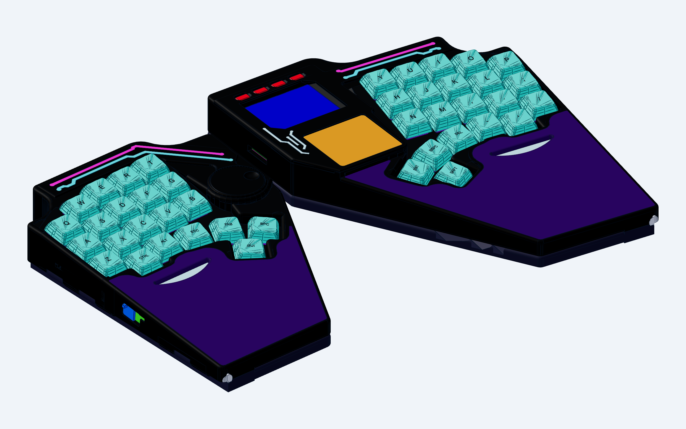
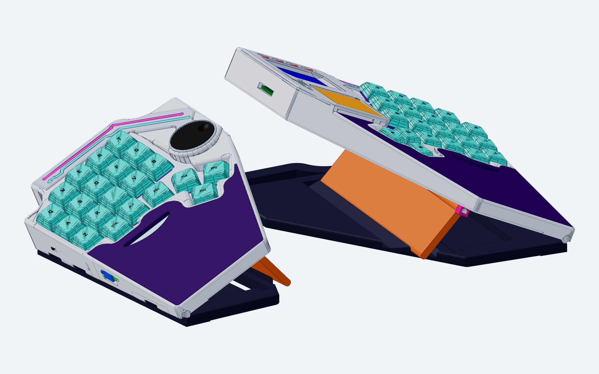
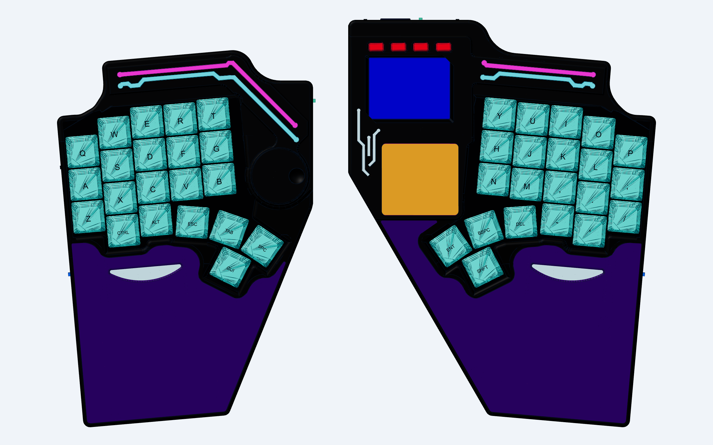
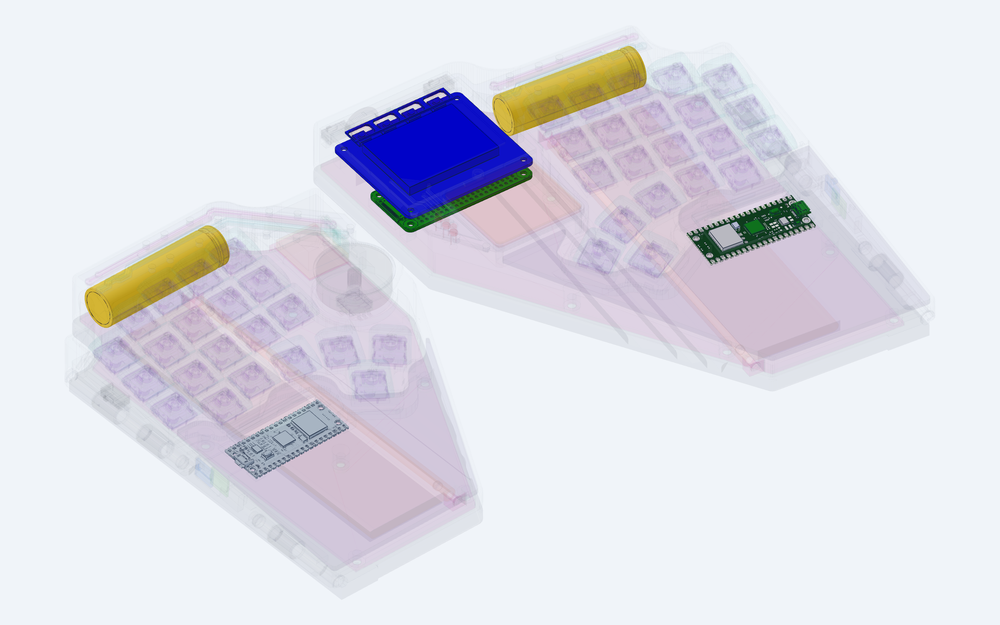
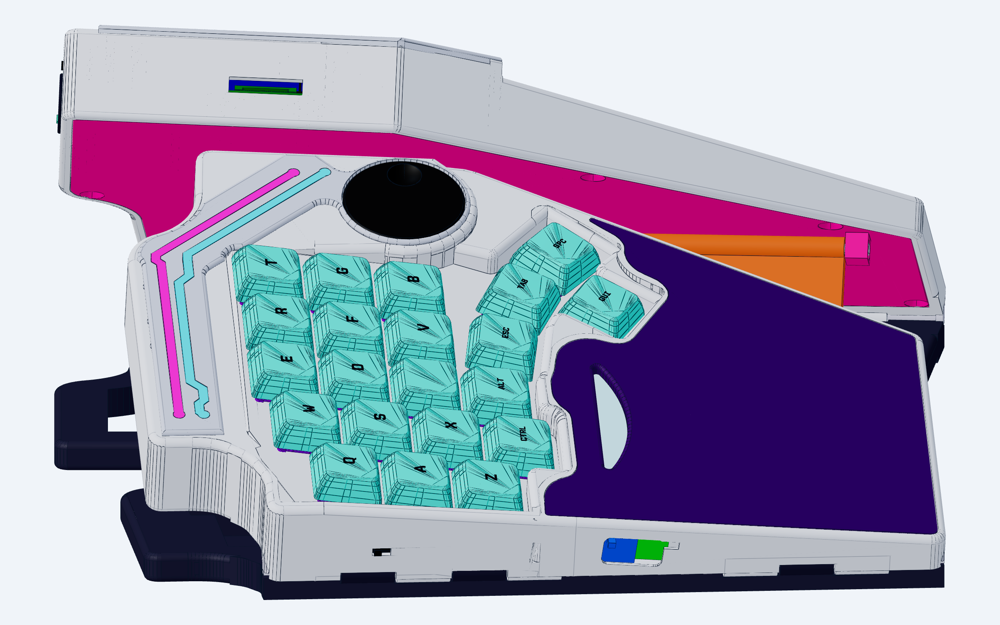
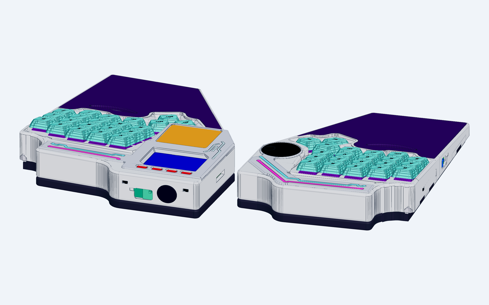
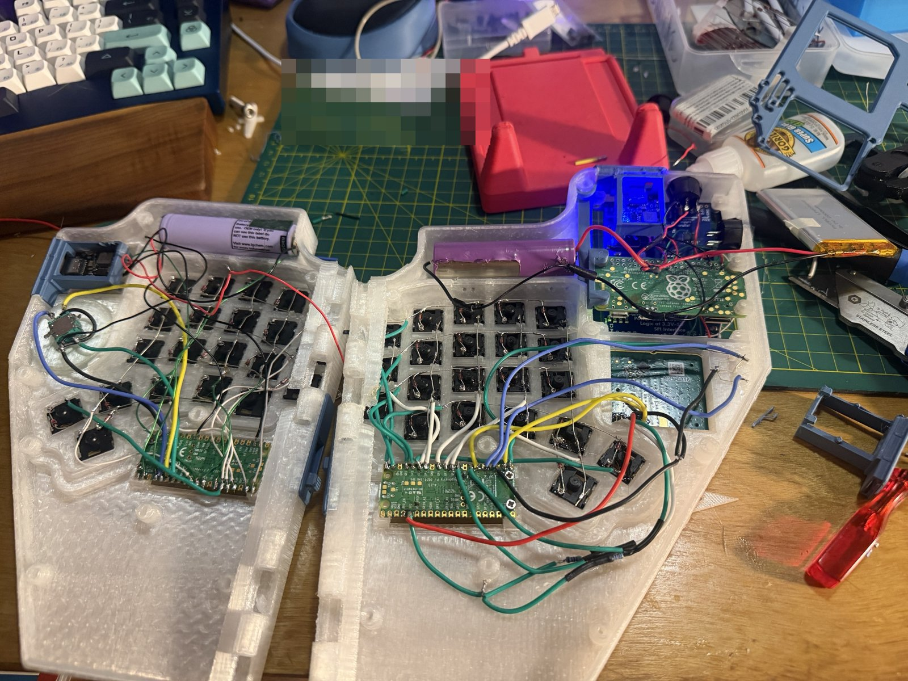
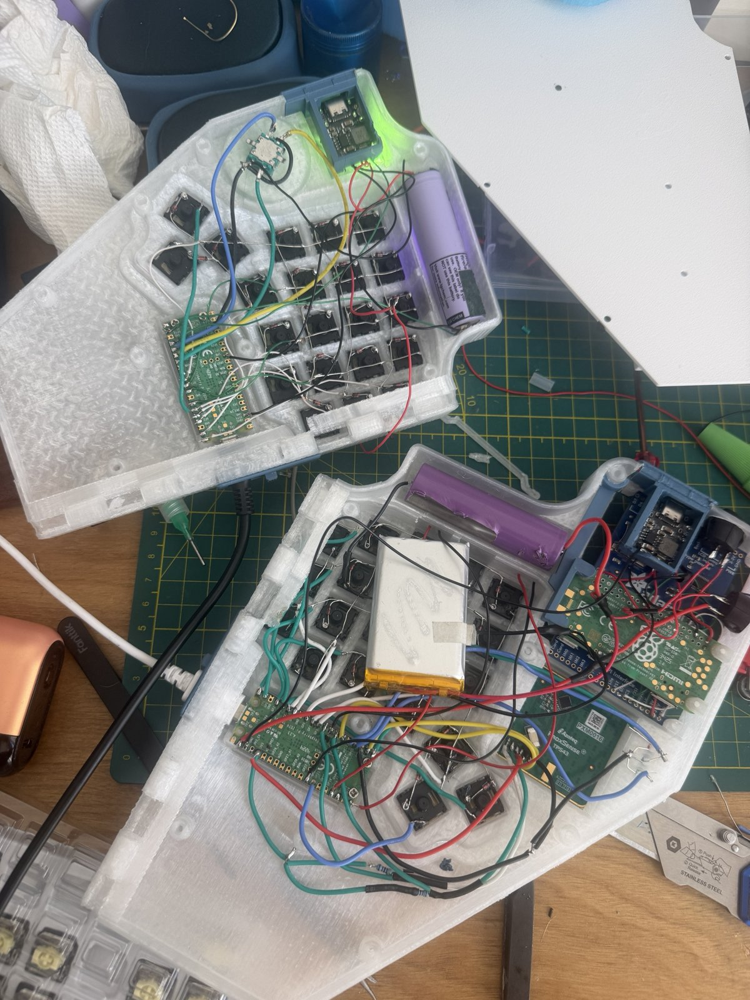
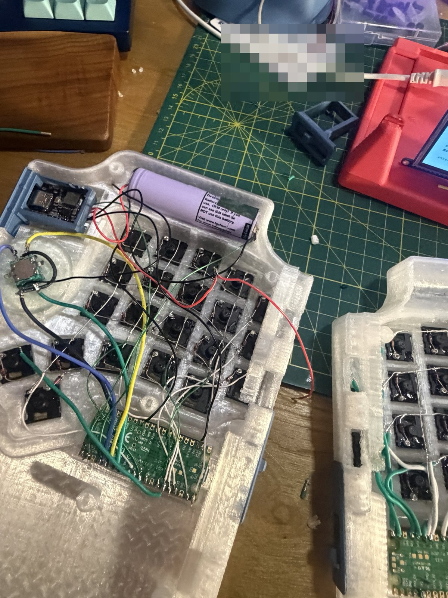
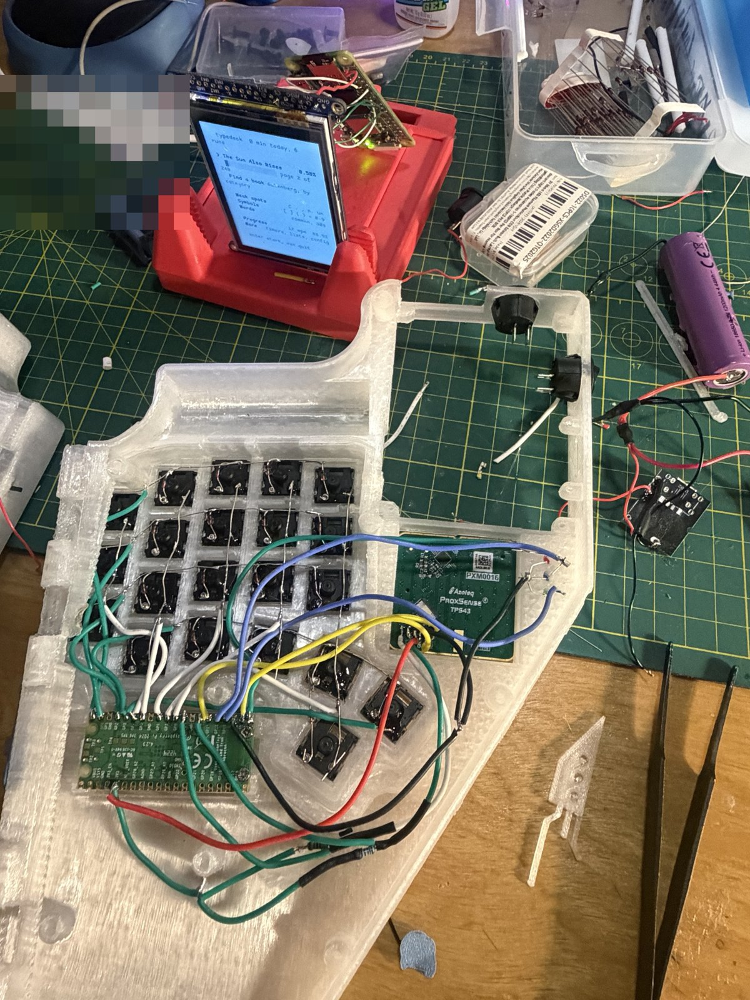

# typedeck

A foldable split keyboard with a Raspberry Pi in it. Each half tents on its own printed stand. The right half carries a Pi Zero 2 W with a 2.2" PiTFT screen and a trackpad. The left half has a big rotary knob and the batteries. Two Pico 2 W boards run the keys over wireless.

Designed in code (build123d) around real catalog STEP files of the parts inside it (key switches, Pi, screen, Picos, encoder, LEDs, slide switches): holes, pockets and clearances are cut from the parts' actual geometry.





| | |
|---|---|
|  |  |
|  |  |

> These are renders. Mid-build photos of the printed halves are below.

## Mid-build



| | |
|---|---|
|  |  |
|  | |

## What's in it

| | |
|---|---|
| Keys | 42 (21 a half): 3 x 5 grid, 2 extra keys under the middle and ring fingers, 4-key thumb arc |
| Switches | Gateron KS-33 Low Profile 2.0 |
| Caps | Uniform-profile 1u. The case is sized for DSA; the build uses an XDA PBT set (fit not yet checked) |
| Controllers | 2x Raspberry Pi Pico 2 W, one per half, wireless |
| Right half | Raspberry Pi Zero 2 W + Adafruit PiTFT 2.2" HAT, trackpad, slide switches |
| Left half | EC11 rotary encoder + printed knob |
| Power | 18650 cells, with print-in-place slide doors over the charge ports |
| Lights | COB LED filaments under clear printed light guides shaped like PCB traces |
| Hinges | Printed pins with a snap ring that clicks into place (no hardware) |
| Screws | 4x M2.5 to hold the Pi stack (2x M2.5 x 6, 2x M2.5 x 12-14) |

## Printing

Ready-to-print plates for a Bambu Lab A1 (256 x 256 bed) are in [`plates/`](plates/), one material per plate. Single parts are in [`stl/`](stl/).

| Plate | Parts | Material |
|---|---|---|
| 00 | Snap-ring fit coupons: print first, pick the ring that clicks | body |
| 01, 02 | Hull R, hull L | body |
| 03, 04 | Base R, base L | body |
| 05 | Hatch R + every pin, spacers, port cover | body |
| 06 | Hatch L + both flaps + knob | body |
| 07 | Both crowns + 4 screen button caps | accent |
| 08 | Light guides, LED diffuser, Pico windows | clear |
| 09 | Trackpad overlay | accent |
| 10 | Wrist pads | TPU |

The hulls and hatches print flat, with designed support walls already in the model. These are thin walls with a 0.2 mm peel gap under the faces that hinges and fences lift off the bed. They're generated by [`cad/print_supports.py`](cad/print_supports.py). In the slicer:

- Supports **on**, tree, **build plate only**: they cover only the ceiling over the keys inside each hull.
- **Don't support bridges: on**: keeps the slicer out of the designed walls' gaps.
- Brim on.

## Source

[`cad/`](cad/) is the full build123d model: hull, stand, hinges, doors, lights, fit checks and tests. It's here to read. Building it needs the private CAD harness it was made in: the cadgen toolchain plus the vendor STEP catalogs (KiCad packages3D, Adafruit CAD Parts, the Gateron KS-33). Those aren't redistributed here.

`print_supports.py` stands alone (trimesh + manifold3d + scipy):

```
python print_supports.py part.stl            # writes part_supported.stl
python print_supports.py --test              # self-check
```
